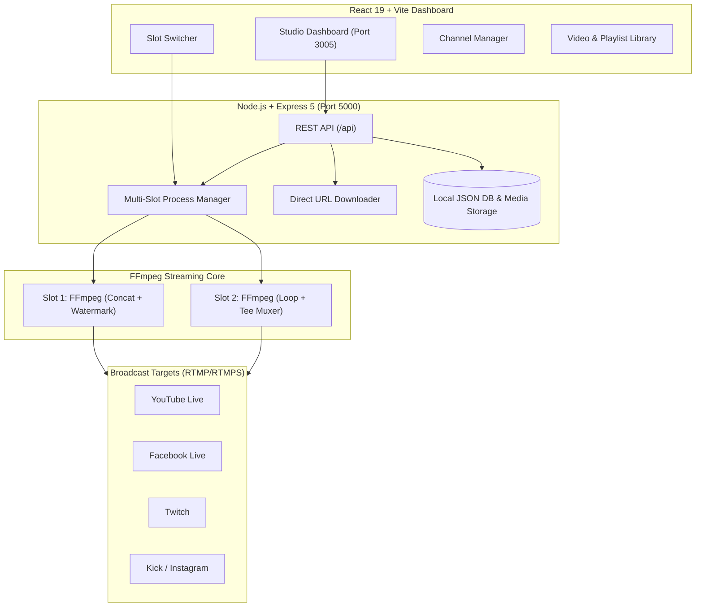

<div align="center">

# ⚡ StreamAdda Cloud Studio

**An open-source, full-stack 24/7 multi-destination live-streaming engine built with React, Node.js, Express, and FFmpeg.**

Broadcast pre-recorded videos and sequential playlists to YouTube, Facebook, Twitch, Kick, and Instagram simultaneously without subscription fees or keeping heavy desktop apps like OBS running.

[](https://react.dev)
[](https://vitejs.dev)
[](https://nodejs.org)
[](https://expressjs.com)
[](https://ffmpeg.org)
[](LICENSE)

[Features](#-key-features) • [Quick Start](#-quick-start) • [Architecture](#-architecture) • [Presets](#-supported-platforms) • [Roadmap](#-roadmap)

</div>

---

## 🌟 Key Features

| Feature | Description |
| :--- | :--- |
| 📡 **Multi-Destination Simulcast** | Broadcast a single video encode to **YouTube, Facebook Live, Twitch, and Kick at the same time** using FFmpeg's `tee` muxer with zero extra CPU re-encoding overhead. |
| 🎛️ **Multi-Slot Architecture** | Run multiple independent streams concurrently (Slot 1: Devotional stream, Slot 2: Lo-Fi beats, Slot 3: Gaming loop) with isolated process controls. |
| ☵ **Continuous Playlists** | Chain multiple videos into ordered playlists that loop seamlessly 24/7 (`-f concat -safe 0 -stream_loop -1`). |
| 🏷️ **Real-Time Logo & Watermarking** | Burn transparent PNG channel logos onto the live stream at runtime with selectable positions (*Top-Right, Top-Left, Bottom-Right, Bottom-Left*). |
| 🌐 **Web Video Downloader** | Paste any direct `.mp4`, `.mov`, `.webm`, or `.mkv` link to download video assets directly to the server library without local uploading. |
| 🔑 **Channel Preset Manager** | Pre-configure and save stream keys with labels (*"My YouTube Main"*, *"Gaming FB Page"*) for instant one-click destination toggling. |
| 🎨 **Obsidian Dark & Clean Light Themes** | Tactile, minimalist studio UI with instant, persisted theme toggling between dark obsidian mode and slate light mode. |
| ⚙️ **Quality Presets** | One-click resolution and bitrate optimization (*720p HD @ 2500k*, *1080p FHD @ 4500k*, *480p SD @ 1200k*). |
| 🔒 **Fail-Safe & Privacy** | Isolated failure boundaries (`onfail=ignore` ensures if one platform drops, others keep broadcasting) + strict log redaction of private stream keys. |

---

## 🏗️ Architecture



---

## 🚀 Quick Start

### Prerequisites
1. **Node.js 20+** installed ([Download Node.js](https://nodejs.org/))
2. **FFmpeg** installed and accessible in your system `PATH` ([Download FFmpeg](https://www.gyan.dev/ffmpeg/builds/))

### 1. Clone & Install
```bash
git clone https://github.com/Shreyansh927/streamingAdda-Project.git
cd streamingAdda-Project
npm install
```

### 2. Configure Environment
Create your `.env` file from the example:
```bash
# On Windows PowerShell:
Copy-Item .env.example .env

# On Linux / macOS:
cp .env.example .env
```

### 3. Start Development Servers
You can run both the frontend and backend in one command:
```bash
npm run dev
```

> **Windows Users**: You can also double-click [`start_dev_servers.bat`](start_dev_servers.bat) to launch everything instantly.

- **Frontend Studio**: [http://127.0.0.1:3005](http://127.0.0.1:3005)
- **Backend API**: [http://127.0.0.1:5000](http://127.0.0.1:5000)

---

## 📡 Supported Platforms

StreamAdda includes built-in RTMP ingest presets for all major broadcasting destinations:

| Platform | Ingest Server URL | Stream Key Location |
| :--- | :--- | :--- |
| **YouTube Live** | `rtmp://a.rtmp.youtube.com/live2` | YouTube Studio ➔ Create ➔ Go Live ➔ Stream Key |
| **Facebook Live** | `rtmps://live-api-s.facebook.com:443/rtmp/` | Meta Business Suite / Live Producer ➔ Stream Setup |
| **Twitch** | `rtmp://live.twitch.tv/app/` | Creator Dashboard ➔ Settings ➔ Stream |
| **Kick** | `rtmps://fa723fc1b171.global-contribute.live-video.net/app/` | Creator Dashboard ➔ Settings ➔ Stream URL & Key |
| **Instagram Live** | `rtmps://live-upload.instagram.com:443/rtmp/` | Instagram Live Producer ➔ Stream URL & Key |
| **Custom RTMP** | Any standard `rtmp://` or `rtmps://` endpoint | Restream, OBS Ninja, CDN, or private RTMP servers |

---

## 📁 Project Structure

```text
streamingAdda-Project/
├── src/
│   ├── App.jsx           # Main Minimalist Studio Component & State
│   ├── main.jsx          # React 19 Entrypoint
│   └── styles.css        # Obsidian Dark & Light Variable Design System
├── server/
│   ├── index.js          # Express 5 REST API, Multi-Slot Runner & FFmpeg Engine
│   ├── data/             # Persisted metadata (videos, channels, playlists, slots)
│   └── uploads/          # Video storage & transparent watermarks
├── start_dev_servers.bat # One-click Windows dev runner
├── vite.config.js        # Vite 6 Dev & Proxy Configuration
├── package.json          # Root dependencies & scripts
└── README.md
```

---

## 🛠️ REST API Reference

| Endpoint | Method | Description |
| :--- | :--- | :--- |
| `/api/status` | `GET` | Health, slot status, active streams, and recent logs |
| `/api/videos` | `GET` / `POST` | List uploaded videos or upload a new media file |
| `/api/videos/import-url`| `POST` | Download video directly from a web URL |
| `/api/videos/:id` | `DELETE` | Remove a video from library |
| `/api/channels` | `GET` / `POST` | Manage saved RTMP destinations |
| `/api/playlists`| `GET` / `POST` | Manage sequential video loop playlists |
| `/api/watermarks`| `GET` / `POST` | Upload and manage transparent brand logos |
| `/api/slots` | `GET` / `POST` | List or create concurrent streaming slots |
| `/api/slots/:id/start` | `POST` | Launch broadcast on a specific slot |
| `/api/slots/:id/stop` | `POST` | Stop active broadcast on a specific slot |

---

## 🗺️ Roadmap

- [x] Multi-Destination Simulcasting (YouTube + FB + Twitch at once)
- [x] Multi-Slot Concurrent Streams
- [x] Continuous Video Playlists
- [x] Web Video URL Importer
- [x] Dynamic Brand Logo & Watermark Overlays
- [x] Dark & Light Mode Theme Switcher
- [ ] Automated Scheduled Streaming (Cron/Timer auto start & stop)
- [ ] Auto-Reconnect Guard for network dropouts
- [ ] Cloud S3 Object Storage integration for video assets

---

## 📄 License

This project is licensed under the [MIT License](LICENSE).
Feel free to use, modify, and distribute it for personal and commercial projects.
